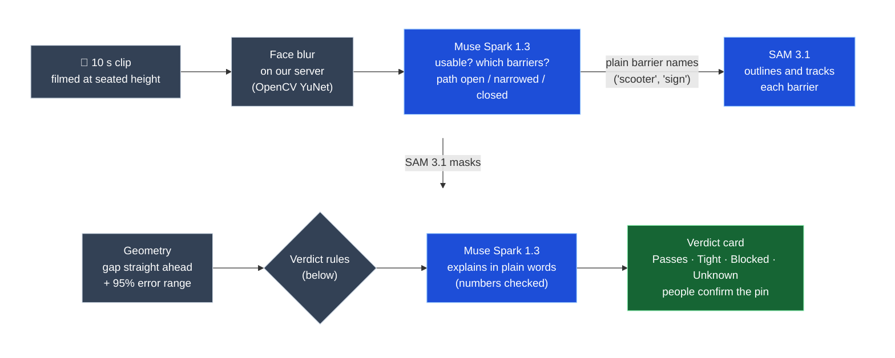
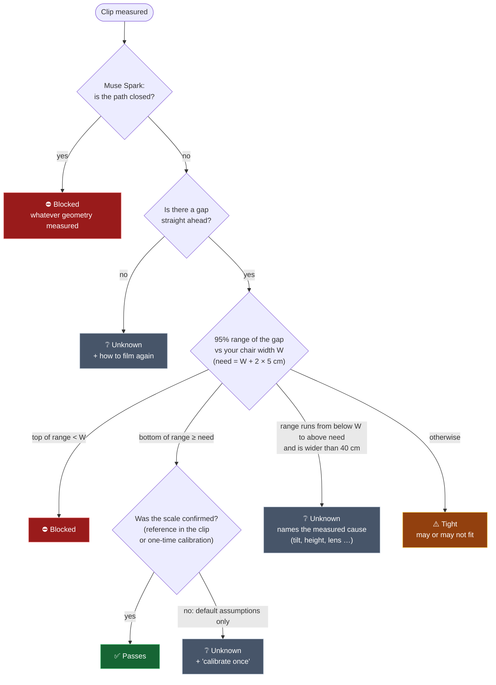
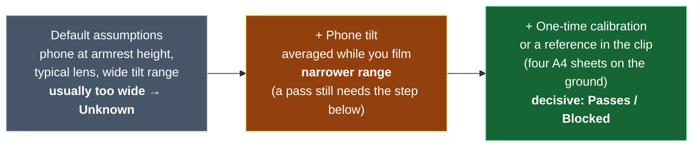
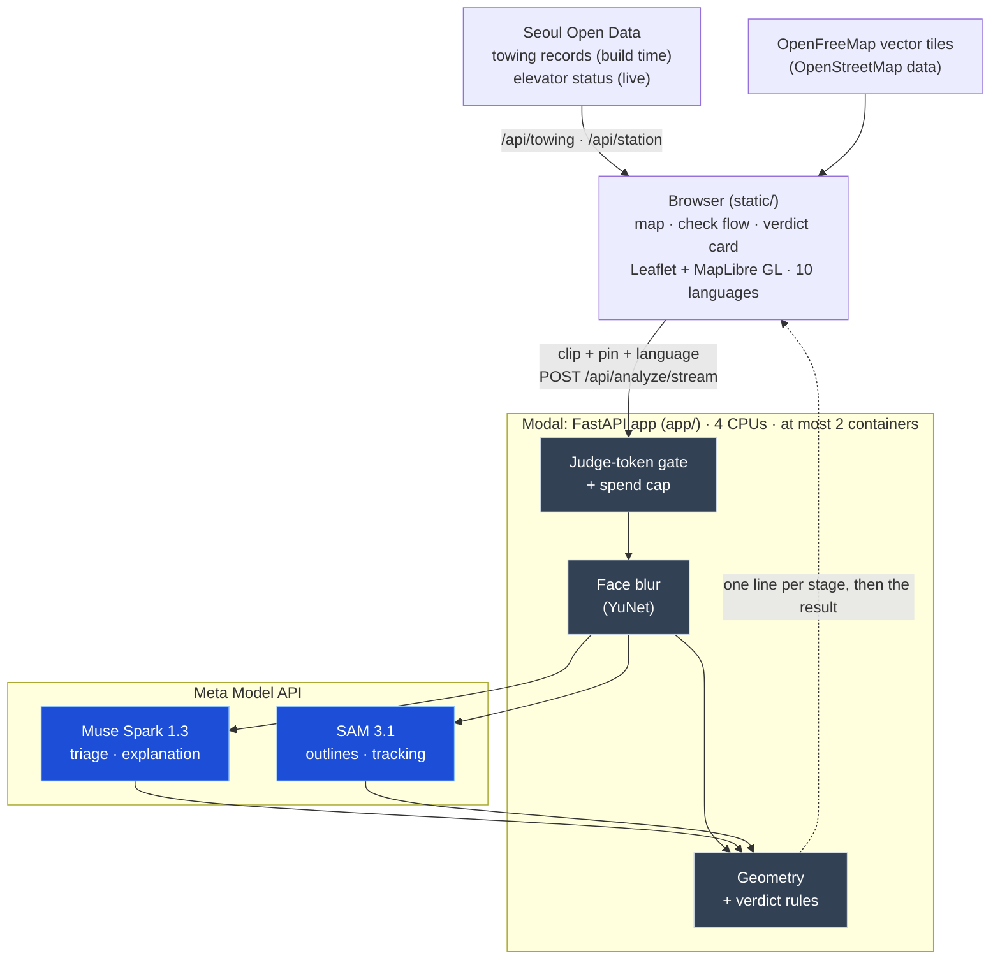

# Barrier Lens

**Turn a 10-second phone clip, filmed at wheelchair height, into a measured answer: does the chair fit past this sidewalk barrier?**

Built during the Meta Global AI Developer Hackathon (build window Oct 27 – Nov 4, 2026, deadline 9 PM ET) · Indie Developer track · Theme: Push the Frontier. First commit: Oct 27, 2026 22:21 ET (Oct 28 11:21 KST). Every line of code here was written in the build window; what is not ours is listed under [Built here, and not ours](#built-here-and-not-ours).

**Muse Spark proposes. SAM 3.1 outlines. Geometry measures. People confirm.**

## Try it in 60 seconds

| | |
|---|---|
| **Live demo** | https://g1mn--barrier-lens-web.us-east.modal.run |
| **1-minute tour** | https://g1mn--barrier-lens-web.us-east.modal.run/#tour (self-running, recorded runs, no sign-in) |
| **Your own clip** | needs the judge token given in the submission, because every live check is a paid call |

Tap **Check a spot**, then one of the three recorded checks. Each is a live run of Muse Spark 1.3 and SAM 3.1 on the Meta Model API, replayed without model calls. None of the three clips was filmed in Seoul, and each says where it is from.

| Button | Verdict | What it shows |
|---|---|---|
| **Sample: known camera** | ✅ **Passes**: 131 cm, 95% range 101–168 | A New York construction corridor ([SANPO](https://github.com/google-research-datasets/sanpo_dataset), Google Research) whose camera height and tilt are known: the same pipeline gives a decisive answer |
| **Sample: closed sidewalk** | ⛔ **Blocked** | Muse Spark reads the SIDEWALK CLOSED sign; the model may only make the answer more cautious |
| **Try a sample** | ❔ **Unknown** | Scooters filmed facing the row: no gap lies straight ahead, so there is nothing honest to measure, and the card says how to film again |

On a wide screen the clip, with SAM 3.1's outlines and the measured ruler, sits beside the verdict.

**What else is on the page**

- **The intro (15 s):** the view dives from a globe to Gwanghwamun Gate (Seoul), tracing South Korea's coast as the globe turns while a card lists what the app does. It then plays one recorded check in a viewfinder (faces blurred → Muse Spark → SAM 3.1 outlines → the measured gap → the verdict). It plays on every load; the ▷ button in the header, or the switch in the language menu, turns it off and back on.
- **The map:** Gwanghwamun Gate and Gyeongbokgung Palace.
  - E-scooter towing reports from Seoul open data: 384 at 128 lot addresses within 500 m of the gate, Aug 2021 – Dec 2025.
  - Live exit-elevator status from Seoul's open-data feed for the two nearest stations, joined to exit positions from OpenStreetMap: Gyeongbokgung (Line 3) exit 4. The feed lists Gwanghwamun's (Line 5) elevator by platform position rather than by exit, so the map does not show it yet.
- **Ten languages:** English (default), 한국어, 日本語, 简体中文, 繁體中文, Español, Français, Deutsch, Tiếng Việt and Bahasa Indonesia, from the 🌐 menu or a link such as `?lang=ko`.
  - The whole page changes: the map's place names, the intro, the tour, the verdict card, the server's sentences and the recorded runs' Muse Spark replies (shown translated).
  - A live check asks Muse Spark to write its explanation in the chosen language; the number check still applies. Only the technical "How we measured" trace stays in English.
  - The 340 strings are listed by `scripts/i18n_strings.py`. The translations were written with Claude Code and are checked by `tests/test_i18n.py` (every string present, same slots and markup).

## How it works



<sub>Blue: Meta models · grey: our code · green: what the person sees.</sub>

| Step | What it does | Where |
|---|---|---|
| Blur | Every frame is face-blurred on our server before anything leaves it (OpenCV YuNet, full frame plus a 2× tiled pass for small faces). | `app/blur.py` |
| Muse Spark 1.3 | Reads six frames spread across the clip, rejects unusable clips, names each barrier with a one-line evidence note, and says whether the walking path is open, narrowed or closed. Strict JSON schema; any distance it writes is rejected. | `app/spark.py`, `app/prompts/triage_system.txt` |
| SAM 3.1 | Segments and tracks each named barrier through the clip (up to three), one phrase per request. On every check it also sends one reference phrase: "paper" when Muse Spark saw a reference, otherwise "tactile paving". | `app/sam.py` |
| Geometry | Turns the masks' ground contacts into a free width with a Monte Carlo error band. The scale comes from a reference of known size (four A4 sheets, a 30 cm tactile block) or from the camera pose (phone height, field of view, tilt). Only the gap straight ahead counts. | `app/geometry.py`, `app/pipeline.py`, `app/calibration.py` |
| Muse Spark 1.3 | Explains the verdict in one or two plain sentences. Every number must appear in the measurement, and an "unknown" must name the measured cause (for example, the tilt was not recorded). Otherwise a fixed sentence is used. | `app/spark.py`, `app/analyze.py` |
| People | Confirm the pin on the map. Sharing it with the next person is not built yet. | `static/app.js` |

## Two rules keep the models honest

1. **What Muse Spark reads about the path can only make a verdict more cautious, never more hopeful,** and a pass needs a reference in the clip or a one-time calibration.
2. **The width always comes from geometry.** The models name things, outline them and explain; they never estimate a distance.



If Muse Spark sees the sidewalk closed, the verdict is *blocked* whatever the geometry measured (sample: *closed sidewalk*). A *pass* is never reported from default assumptions alone: it needs a reference in the clip or a one-time calibration. The phone's tilt narrows the band but does not replace the calibration. A band wider than 40 cm that spans both "does not fit" and "fits" is reported as **unknown**, never as "tight"; a narrower band that overlaps the chair width is *tight* (may or may not fit) (`app/geometry.py` `verdict_for`, `app/analyze.py` `apply_path_and_mode`).

## Why SAM 3.1

No SAM 3.1 mask, no measurement: geometry measures between the masks' ground contacts, so the outline *is* the measurement.

- **Plain words in, masks out.** SAM 3.1 takes the barrier names Muse Spark wrote in plain words ("scooter", "construction barrier") as its prompts and returns a mask for each object, tracked through the whole clip. Tracking picks the frame where the most barriers are outlined together and draws the outlines through the clip (a calibration takes the median over tracked frames); the width itself is measured on that one frame.
- **A concept reached further than its word.** In the known-camera run SAM found nothing for "construction fence", yet its "construction barrier" outlines took in that orange mesh fence too, and the measured 131 cm runs from the fence to the first water-filled barrier (`static/demo/sanpo-corridor-live.json`: frame 77, objects 4 and 1; `docs/sanpo-check.md`).
- **No taps, no stitching.** Someone filming from a wheelchair never taps or draws a box, and we stitch no separate barrier detector and tracker together.
- **Cost.** A check cost $0.03–0.06 of SAM in our runs, at most $0.08 (ten seconds at 10 fps, three barriers plus a reference).
- **Where it fell short** (`docs/vocab.md`). When it finds nothing, a clip stays *unknown* without a tilt reading or a one-time calibration.

| Phrase sent to SAM 3.1 | Frames found |
|---|---|
| "scooter" | 30 of 30 |
| "e-scooter" (same clip) | 0 of 30 |
| "sign" (closed sidewalk) | 30 of 30 |
| "barricade", "road barrier", "sawhorse" (same clip) | nothing |
| "tactile paving" (hoped-for 30 cm scale reference) | nothing, under four phrasings |

The triage prompt suggests 13 plain nouns (scooter, sign, traffic cone, construction barrier and others); in the recorded runs SAM found scooter, sign, traffic cone and construction barrier but not bicycle or construction fence, and code rewrites "e-scooter" as "scooter". A barrier SAM returns nothing for is not measured on its own (but see the fence above).

## Calibrate once

With default assumptions alone, the error band is usually too wide to decide. The app says so and offers the fix. Each step narrows the range:



- **Phone tilt:** turn on *Use phone tilt* (automatic on Android, one tap on iPhone). The tilt is averaged while you film and sent with the clip.
- **Profile:** wheelchair width and armrest height (the phone's height), and optionally the phone's main-camera focal length.
- **One reference clip:** lay four A4 sheets (or one tactile block) flat on the floor, hold the phone at your armrest and film three seconds. The app solves the phone's height and tilt offset once (`solvePnP`) and uses them for every later check.

Every result is labelled *Estimated with default assumptions*, *Calibrated* or *Measured against a reference in the clip*. The *known camera* sample shows what calibration buys: a public dataset clip whose camera height and tilt are known gets a decisive answer from the same pipeline (below).

## Architecture



## What we measured

Numbers below come from files in this repo. Samples are small and labelled as such.

**Public photos with a known length on the ground** (`data/eval/`, `scripts/eval_public.py`, no model calls; three images, a smoke test, not a benchmark). Each cell is the 95% range; ✓ means it contains the true value:

| Photo | What is known | Default (seated) | Camera height guessed, lens known | Plus tilt |
|---|---|---|---|---|
| Graz, Kronesgasse (CC0) | clear width 85 cm, kerb edge to wall base | 20–124 ✓ | 40–234 ✓ | 55–137 ✓ |
| Teltow (CC BY 3.0) | a 1 m folding ruler lying across the path | **37–57 ✗** | 74–124 ✓ | 75–112 ✓ |
| Altenplathow bridge (CC BY-SA 4.0) | path width 230 cm (our reading: between parapets) | 64–420 ✓ | 88–930 ✓ | — |

The ranges are honest but wide: half the verdicts are "unknown", and the Teltow default is a confident wrong "blocked" (37–57 cm, truth 100 cm). The Teltow row is the point: with default assumptions the app can be confidently wrong about scale, which is why a pass needs confirmation and why calibration matters.

Three caveats about these photos:
- They were taken standing, so the seated default is the wrong assumption for them. In the app, Muse Spark is asked to check that a clip was filmed at seated height; that is a model judgement, and it passed the chest-height SANPO clip.
- The camera heights in the middle columns are guesses from the viewpoint.
- The "tilt" column takes the tilt from lines on the ground, not from an independent sensor.

**Recorded live runs** (`static/demo/*.json`: two Pexels clips and one SANPO clip, first 10 s each; none was filmed in Seoul, so the map pin a sample drops is illustrative):

| Clip | Muse Spark path | Verdict | Explanation |
|---|---|---|---|
| Construction corridor, New York (SANPO, known camera) | narrowed | ✅ passes, 131 cm, range 101–168 (65 cm chair) | "You have about 131 cm to get past, so you should fit through with room to spare." |
| Sidewalk closed for construction (Pexels) | closed ("a sidewalk closed barricade stands across the path with cones and work equipment beyond") | ⛔ blocked (geometry alone could not decide: 38 cm, range 12–116) | "You cannot get through because the sidewalk is closed off with a barricade and cones ahead." |
| Scooters parked along a fence, filmed facing the row (Pexels) | narrowed | ❔ unknown: no gap between the outlined scooters lies straight ahead | asks to film facing the gap, with both sides in view |

The known-camera clip is 10 s of the [SANPO](https://github.com/google-research-datasets/sanpo_dataset) dataset (Google Research, CC BY 4.0), filmed at chest height.
- **Where its camera numbers come from.** Its camera height (1.16 m, from frames 300–450 of the same walk) and tilt (12.1° down, averaged over the clip) come from the dataset's stereo depth by a ground-plane fit. They stand in for a one-time calibration and the phone's tilt sensor. The dataset's own IMU poses drift by 2–10° against the ground within 10 s, so they were not used.
- **Check** ([docs/sanpo-check.md](docs/sanpo-check.md)). At the two gap ends the app measured, the dataset's stereo depth gives 117 cm, and that frame's own ground plane gives 124 cm. Both lie inside the app's 101–168 cm range. The stereo depth is itself an estimate (CREStereo), so this is a consistency check, not ground truth.

**Cost and time per live check** (measured on the deployed app, Modal, 4 CPUs):

| | |
|---|---|
| Time | a 7 s clip takes about a minute end to end; face blur and SAM take most of it, and the page shows each stage's time as it runs |
| SAM 3.1 | $0.03 for a 7 s clip with two concepts, $0.06 for a 10 s clip with three; at most $0.08 (10 s, three barriers plus a reference) |
| Muse Spark 1.3 | ran on the hackathon's free Meta Model API credits (not priced here) |

## Tests

152 tests (`tests/`, run on Python 3.13 and 3.15; the demo video shows 151, from before the last pre-freeze fixes). They cover:
- geometry on synthetic scenes with known truth
- the error-band and verdict rules, and the straight-ahead gap rule
- camera-pose solving and SAM replay fixtures
- the explanation's number and cause checks, and the triage distance guard
- the path-closed and default-pass rules
- the streaming route and the demo-token gate
- that every language file has every string, with the same slots and markup

```bash
python3.13 -m venv .venv && .venv/bin/pip install -r requirements-dev.txt
.venv/bin/python -m pytest -q
```

**Pre-freeze review by Muse Code** (Meta's coding agent, `muse exec` with `muse-spark-1.3`, Oct 29). Every change it wrote was reviewed and applied unchanged.

- **First run.** It read the pipeline, ran the tests and reported six defects; all six checked out against the code. It then wrote fixes for five of them, with one test each, in its own git worktree:
  - a sidewalk Muse Spark saw closed is now *blocked* even when no barrier is named (it was *unknown*);
  - the tactile-strip mode now uses the straight-ahead rule (it still chose the widest corridor anywhere);
  - the Monte Carlo band matches each draw's passage by label, not position;
  - Muse Spark calls are priced in the spend ledger, so the cap counts them;
  - a malformed model reply is a 502, not a 500.

  The sixth defect (upload file type) was left as is: uploads already need the judge token, and a suffix check would not stop a crafted file.
- **Second run.** It wrote the three tests for the number and distance guards, and the page fixes from our pre-release licence audit (map credits visible on phones, sample clips labelled as filmed elsewhere, reused SAM masks not shown as $0.00).
- **Later runs** wrote:
  - the change that stops storing VWorld geocoder results (distance bands only);
  - the move of the demo area to Gwanghwamun with two stations;
  - the self-running 1-minute tour;
  - the first opening globe intro (since replaced by the 15-second intro above, which we wrote ourselves).

## Run it

```bash
# keys live outside the repo: ~/.config/barrier-lens/.env (META_API_KEY; optional SEOUL_OPEN_DATA_KEY)
.venv/bin/python -m uvicorn app.main:app --app-dir . --port 8799
```

- **Replay mode:** with neither `META_API_KEY` nor `BASETEN_API_KEY` set (or with `SPARK_BACKEND=replay`), the app uses only cached and fixture results and makes no paid calls.
- **Deploy:** `modal deploy modal_app.py` (secrets in a Modal secret named `barrier-lens`), or the `Dockerfile` on any container host.
- **On a public deploy:** set `BL_DEMO_TOKEN` so only token holders can start paid checks. `BL_SPEND_CAP_USD` caps model spend per ledger file (on Modal, per container; at most two containers).

Main routes:

| Route | What it returns |
|---|---|
| `POST /api/analyze` | one JSON result |
| `POST /api/analyze/stream` | one line per stage, then the result |
| `GET /api/sample?name=scooters\|closed\|known` | a recorded run |
| `POST /api/calibrate` | camera height and tilt from a reference clip |
| `GET /api/towing`, `GET /api/station` | the map's towing reports and station elevators |

## Data and licences

- **Seoul Open Data Plaza:** e-scooter towing records OA-23057 and station facilities OA-15994, OA-21212, OA-21211 (Korea Open Government License Type 1). Each lot address is placed in a 300 / 500 / 1000 m band from Gwanghwamun Gate by geocoding it with VWorld (국토교통부 브이월드) at build time. VWorld's terms allow real-time use only, so no coordinates are stored. See `data/seoul/ATTRIBUTION.txt`.
- **Station exits, station and gate positions:** © OpenStreetMap contributors, ODbL 1.0.
- **Base map:** OpenFreeMap vector tiles (OpenMapTiles schema, OpenStreetMap data; free public instance, no key), in its Liberty style.
  - Drawn by MapLibre GL JS 5.24.0 (BSD-3-Clause) and joined to Leaflet by maplibre-gl-leaflet 0.1.4 (ISC, jsDelivr).
  - Place names follow the page language (`name:<lang>`, then English or the Latin spelling, then the Korean name).
  - Without WebGL the map falls back to the OpenStreetMap raster tiles.
- **Intro:**
  - Land shapes: world-atlas 2.0.2 (ISC), built from Natural Earth 1:110m land and 1:10m South Korea (public domain), in `static/vendor/`.
  - The globe is drawn with MapLibre GL JS 5.24.0 (BSD-3-Clause, from cdnjs). The base map fades in over it from the same vector tiles, so the dive lands on the map's exact view.
  - It draws the base map only at zoom levels 6, 9, 12 and 14 (about 1.9 MB, fetched before the dive starts) and any zoom in between from the level below, so on a slow connection no zoom is blank and no tile pops in late.
  - The camera tilts toward the horizon over South Korea and is level again before the base map appears.
  - Its clip is 3 s of the SANPO session above, blurred again and interpolated to 30 fps (details in `static/demo/ATTRIBUTION.txt`).
- **Evaluation photos:** Wikimedia Commons, CC0 / CC BY 3.0 / CC BY-SA 4.0, credited in `docs/eval-sources.md`.
- **Demo clips:** credited in `static/demo/ATTRIBUTION.txt`.
  - Pexels License: two clips. A third Pexels clip is the upload in the demo video's live run and the source of the SAM test fixtures (masks only).
  - SANPO, CC BY 4.0: one clip, changes listed.
- **Face detector:** OpenCV Zoo YuNet (MIT), downloaded at build time with a pinned hash.

## Limitations

- Licence plates are not detected (no plate detector in OpenCV 5). We check demo frames by eye.
- The measurement uses one frame; masks that do not reach the ground make a barrier look further away than it is.
- With the tilt sensor off, the tilt is not estimated from the clip: a wide range of tilts is assumed (lines on the ground are used only in the offline photo evaluation above).
- The way through is the widest gap straight ahead: a neighbouring pair that straddles the image's centre column and stands side by side, not one behind the other.
  - Gaps elsewhere are listed but never chosen. This assumes you film facing the gap you want to pass.
  - A barrier dead ahead is measured only on the side of the centre line it leaves open.
  - Before Oct 29 the widest gap anywhere was chosen, and a corridor between a fence and a row of jersey barriers measured 13 m, to objects beyond the row.
- The four-A4 floor reference has been checked on synthetic masks only, not yet on real SAM 3.1 output for four separate sheets. The code takes the highest-scoring "paper" object in the frame, so it assumes SAM returns the 2×2 sheets as one object.
- No medical or health advice, by design: the app only compares a measured width with a stated chair width.

## Built here, and not ours

- **Built in the window (ours):**
  - everything under `app/`: the pipeline, geometry and error bands, the straight-ahead rule, calibration, the face-blur tiling and merging, the model-output checks
  - `app/prompts/`, `static/index.html`, `static/app.js`, `static/app.css`, `scripts/`, `tests/`, `docs/`, `modal_app.py`, `Dockerfile`

  Written with AI coding assistants (Claude Code; Muse Code for the review and the changes listed under *Tests*). Every commit is in the window, and commits written by Muse Code say so.
- **Not ours:**
  - Muse Spark 1.3 and SAM 3.1 (Meta Model API)
  - `meta-sam-parser` (Meta, SAM License, installed from PyPI)
  - OpenCV and the YuNet face detector (Apache-2.0, MIT)
  - Leaflet 1.9.4 (BSD-2), MapLibre GL JS 5.24.0 (BSD-3-Clause) and topojson-client 3.0.2 (ISC), all from cdnjs, and OpenStreetMap tiles (ODbL)
  - FastAPI, uvicorn, httpx, numpy, python-multipart
  - the data and media listed above

## License

MIT for the source code (`app/`, `static/*.html|css|js`, `scripts/`, `tests/`, `modal_app.py`, `Dockerfile`) — see [LICENSE](LICENSE). Files under `data/eval/`, `data/seoul/` and `static/demo/` keep their own licences (see *Data and licences*, `docs/eval-sources.md`, `data/seoul/ATTRIBUTION.txt`, `static/demo/ATTRIBUTION.txt`).
